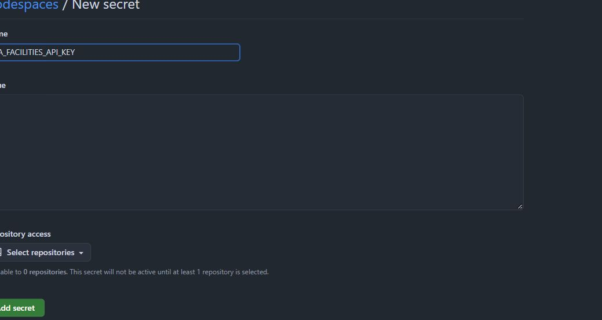

# Run the MCP server in GitHub Codespaces

Start with a sample Primary Care scheduling request. Then connect the same server to the **VA Facilities sandbox API** and ask for the Topeka facility. You can finish the first checkpoint with a GitHub account that has Codespaces access. For the second, **you supply your own VA Facilities sandbox key**. Both checkpoints run independently of IBM, LiveKit, Deepgram and Supabase.

## Checkpoint 1 · Which appointments fit the request?

### Open a terminal in your browser

1. Sign in to GitHub and open the [submission repository](https://github.com/gsa-mcp-hackathon/veteran-access-bridge-mcp-server). Confirm that the branch above the file list says **main**.
2. Select **Code → Codespaces → Create codespace on main**. If the menu lists an existing Codespace, check its repository and branch before resuming it. Use a fresh Codespace to reproduce the release from the beginning.
3. Wait for the editor to finish setting up. Open **Terminal → New Terminal**. If the menu bar is collapsed, open the menu in the upper left to find **Terminal**. Paste commands in the terminal, one block at a time, and press **Enter**.

**Setup note.** The project setup script prints `Veteran Access Bridge Codespace is ready.` followed by a list of secrets for live voice. Those belong to the Avery browser call. Continue here with the bundled scheduling records.

### Find the project and install its dependencies

```bash
git rev-parse --show-toplevel
```

The path should end in `/veteran-access-bridge-mcp-server`. If Git says it cannot find a repository, open the project folder and start a new terminal there.

```bash
git rev-parse --short HEAD
```

Save the short commit ID. It identifies the version you are reviewing.

```bash
uv sync --locked --group dev --python 3.12
```

This prepares Python and the packages listed in the project's lockfile. Wait for the terminal prompt to return. If the shell says `uv: command not found`, first wait for Codespace setup to finish. If the installer put uv in your home directory, run `export PATH="$HOME/.local/bin:$PATH"`, then retry.

### Discover tools and send the scheduling request

```bash
uv run --no-sync python scripts/list_local_mcp_tools.py
```

Look for `get_scheduling_encounter` and the line **21 tools advertised by this configuration** in the default setup. The command starts the server, connects an MCP client, lists the tools and exits. The next command starts its own session.

```bash
uv run --no-sync python scripts/read_scheduling_encounter.py DEMO-PC-5000999-001
```

This case represents an established patient requesting a 30-minute, in-person Primary Care follow-up. Read the `slot_eligibility` entries:

| Slot from the sample inventory | Eligible | How to read the answer |
|---|---|---|
| `VISTA-SLOT-PC-5000999-001` | true | Fits the scheduling request. |
| `VISTA-SLOT-PC-5000999-002` | false | The new-patient slot conflicts with the visit intent, patient classification and appointment template. |
| `FEHR-SLOT-PC-5000999-001` | true | Also fits the request. |

**Checkpoint:** Three sample slots checked, two qualified. The final fields, `read_only: true` and `booking_created: false`, tell you the lookup created no booking. These records came from the repository. The next checkpoint uses an external data source.

## Checkpoint 2 · Look up a facility through VA

### Request your own API key

Open the [VA Facilities API sandbox access form](https://developer.va.gov/explore/api/va-facilities/sandbox-access). Enter your name, email, organization and a brief project description. For example, adapt “I’m testing a scheduling prototype that uses the VA Facilities API to look up public facility information by station ID.” Review the terms and submit the form if you agree. Continue once you have your sandbox key.

### Save the key for your Codespace

1. On GitHub, select your **profile picture → Settings → Codespaces → New secret**. You can also [open the personal Codespaces secret form](https://github.com/settings/codespaces/secrets/new).
2. For **Name**, enter `VA_FACILITIES_API_KEY`. For **Value**, paste the key issued to you by VA.
3. Under **Repository access**, choose **Select repositories** and select the repository where you launched your Codespace. If you launched it from your own fork, select that fork. Select **Add secret**.



The secret belongs to your GitHub account. It is made available to your Codespace through its environment. Keep its value out of project files. [GitHub's instructions for personal Codespaces secrets](https://docs.github.com/en/codespaces/managing-your-codespaces/managing-your-account-specific-secrets-for-github-codespaces)

### Restart and check the connection settings

On [Your codespaces](https://github.com/codespaces), find the Codespace for this repository, open its **…** menu and choose **Stop codespace**. Once stopped, click its name to restart it. Open **Terminal → New Terminal** again.

```bash
if [ -n "${VA_FACILITIES_API_KEY:-}" ]; then echo "Key available"; else echo "Key missing"; fi
```

**Key available** means the shell received a value. VA will validate it on the next request. If you see **Key missing**, check the spelling and the selected repository in your personal Codespaces settings, then stop and restart the same Codespace.

```bash
export VA_SANDBOX_ENABLED=true
export VA_FACILITIES_READ_ENABLED=true
```

Run the remaining commands in this terminal. The adapter checks both settings: one enables VA sandbox access and the other enables facility reads.

### Check the key directly with VA

Paste this entire block, including the final `PY` line. It sends one GET request to VA and prints the HTTP status and public facility details. It reads the key from the environment.

```bash
uv run --no-sync python - <<'PY'
import os
import httpx

url = "https://sandbox-api.va.gov/services/va_facilities/v1/facilities/vha_589A5"
response = httpx.get(url, headers={"apikey": os.environ["VA_FACILITIES_API_KEY"]}, timeout=15)
print("HTTP", response.status_code)
response.raise_for_status()
facility = response.json()["data"]
print("Facility ID:", facility["id"])
print("Facility name:", facility["attributes"]["name"])
PY
```

Expect **HTTP 200** and **vha_589A5**. Keep the returned facility name on screen for the comparison below. If you receive **401** or **403**, check that VA issued the key for the Facilities sandbox and that you saved the correct value. [VA Facilities API reference](https://developer.va.gov/explore/facilities/docs/facilities)

### Ask the MCP server for the same facility

Paste the whole block into the same terminal. This example uses the installed MCP client library and the repository’s existing server and tool. The client passes the three VA settings to the server it starts.

```bash
uv run --no-sync python - <<'PY'
import asyncio
import json
import os
import sys

from mcp import ClientSession, StdioServerParameters
from mcp.client.stdio import stdio_client

async def lookup():
    settings = {"VAB_MCP_TRANSPORT": "stdio"}
    for name in ("VA_SANDBOX_ENABLED", "VA_FACILITIES_READ_ENABLED", "VA_FACILITIES_API_KEY"):
        settings[name] = os.environ.get(name, "")
    server = StdioServerParameters(
        command=sys.executable, args=["-m", "veteran_access_bridge.mcp.app"], env=settings
    )
    async with stdio_client(server) as streams, ClientSession(*streams) as session:
        await session.initialize()
        reply = await session.call_tool("get_va_sandbox_health_facility", {"facility_id": "vha_589A5"})
        if reply.isError:
            raise SystemExit("MCP tool call failed. Check the server messages above.")
        result = reply.structuredContent or json.loads(reply.content[0].text)
        for field in ("status", "facility_id", "name", "source", "source_verified"):
            print(f"{field}: {json.dumps(result.get(field))}")

asyncio.run(lookup())
PY
```

| Compare | Direct VA request | MCP request with a working key |
|---|---|---|
| Success | HTTP 200 | `status: "AVAILABLE"` |
| Facility | `vha_589A5` and the returned name | Same ID and name |
| Evidence of source | Request went to the VA sandbox host | `source: "VA_FACILITIES_API_SANDBOX"` and `source_verified: true` |

**Checkpoint:** Count this as a connected read only when both results agree and the source is verified. Facility metadata identifies a location. It does not establish a patient's assigned clinic, list open appointments or create a booking.

**VA worked but MCP says UNAVAILABLE?** Check that you ran both export commands and the key check in the same terminal as the MCP command. An unavailable response with `source_verified: false` is a failed lookup. For a comparison without a key, run the MCP block in a subshell after unsetting the key there. Your personal GitHub secret stays saved.

**Finished?** Stop your Codespace from [Your codespaces](https://github.com/codespaces). To explore the example further, [run the scheduling answer key](local-mcp-server.md#compare-with-the-answer-key).
