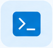

<link rel="stylesheet" href="../stylesheets/developer-landing.css">

<header class="start-hero">

Developer Guide

<h1>Veteran Access Bridge</h1>

Run the MCP server, test scheduling with example data, or build the full Avery voice scheduling experience.

</header>

<h2 class="start-question">What do you want to do?</h2>

<section class="start-card">
<header>
<h3>I want to run the MCP server and try a scheduling request.</h3>

Use the included test data to run the server and send a scheduling request end-to-end. No IBM account required.

</header>

<h4>Choose where to run it:</h4>

In my browser with GitHub Codespaces

<strong>Start in GitHub</strong><ol><li>Sign in to GitHub and open the <a href="https://github.com/gsa-mcp-hackathon/veteran-access-bridge-mcp-server">submission repository</a>.</li><li>Select <b>Code → Codespaces → Create codespace on main</b>. GitHub opens a development environment in your browser.</li><li>When setup finishes, open <b>Terminal → New Terminal</b>. The terminal is where you enter the commands in the guide.</li></ol><a href="codespaces/">Follow the Codespaces walkthrough →</a>

On my computer with VS Code

<strong>Start on your computer</strong><ol><li>Install <a href="https://code.visualstudio.com/download">VS Code</a>, <a href="https://git-scm.com/downloads">Git</a>, <a href="https://www.python.org/downloads/">Python 3.12</a> and <a href="https://docs.astral.sh/uv/getting-started/installation/">uv</a>, the project's package manager.</li><li>Open VS Code, choose <b>Terminal → New Terminal</b> and copy the repository to your computer:</li></ol>
<pre><code>git clone https://github.com/gsa-mcp-hackathon/veteran-access-bridge-mcp-server.git</code></pre>

Choose <b>File → Open Folder</b>, select <b>veteran-access-bridge-mcp-server</b>, then open a new terminal in that folder.
<a href="vs-code/">Follow the VS Code walkthrough →</a>

<footer><b>Quick start</b>·Run with the included sample data.</footer></section>

<section class="start-card start-voice">
<header>
<h3>I want to build the full Avery voice scheduling experience.</h3>

Connect the MCP server to the services behind the call to run Avery — a conversational voice scheduling experience.

</header>

<h4>Full setup uses these services:</h4>

IBM CloudLiveKitDeepgramSupabaseVA Sandbox

<h4>Choose your path:</h4>

I already have IBM Cloud

<strong>Check what is provisioned</strong><ol><li>Open your <a href="https://cloud.ibm.com/resources">IBM Cloud resource list</a>. Find your <b>watsonx Orchestrate</b> instance. This is where Avery and its tools are configured.</li><li>Open <a href="https://cloud.ibm.com/codeengine/projects">Code Engine projects</a> and identify the project for the scheduling backend. If either service is missing, provision it in your own account.</li><li>Prepare the test database, VA access and voice services before attempting the browser call.</li></ol><a href="connected-product/#reproduce-the-connected-voice-product">Connect your services and check each layer →</a>

I’m starting from scratch

<strong>Start with the service accounts</strong><ol><li><a href="https://cloud.ibm.com/registration">Create an IBM Cloud account</a>. Set up Code Engine to host the backend and watsonx Orchestrate to run Avery.</li><li><a href="supabase/">Prepare Supabase</a>. Create a test database, apply the project schema and load synthetic cases and appointment slots before the first call.</li><li><a href="vha-sandbox/">Set up VA sandbox access</a> for the patient and facility reads.</li><li>Create a <a href="https://cloud.livekit.io/">LiveKit project</a> for the browser call and a <a href="https://console.deepgram.com/">Deepgram key</a> for speech. Connect the voice worker and browser app to your backend.</li></ol><a href="connected-product/#reproduce-the-connected-voice-product">Open the configuration and verification guide →</a>

<footer><b>Full setup</b>·Configure services, deploy, and run the voice experience.</footer></section>

<nav class="start-resources" aria-label="Developer resources">

<strong>What’s included</strong><a href="../mcp-implementation/">MCP server</a><a href="local-mcp-server/">Test data</a><a href="connected-product/">Deployment guides</a><a href="deepeval/">Evaluation (DeepEval)</a><a href="phoenix/">Tracing (Phoenix)</a>

<strong>Other resources:</strong><a href="../solution-architecture/">Architecture →</a><a href="../mcp-implementation/#representative-mcp-contracts">API Reference →</a>

</nav>

