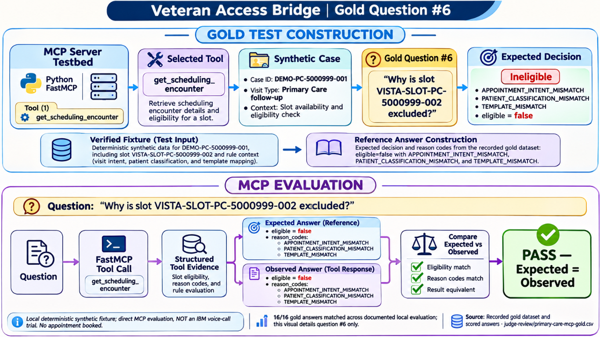

# Evaluation & Results

Our evaluation strategy separates **MCP technical correctness**, **agent tool selection**, **security boundaries**, **voice experience** and **persisted outcomes**. Results are tied to their recorded checkpoints. They are **not** one combined pass rate.

## Evidence at a glance

<strong>1,380</strong>Linux tests passed Nov 16; 19 skipped

<strong>108/108</strong>MCP contract probes Nov 16

<strong>76/76</strong>Hostile argument probes Nov 16

<strong>1</strong>Persisted synthetic booking Nov 16 acceptance

## Interactive evaluation checkpoints

The searchable report below uses a **bundled local JSON file**; it makes no live API calls, and does not imply new runs. Filter by evaluation category or status and read each checkpoint's caveat.

Loading locally bundled checkpoints…

<noscript>JavaScript is optional. The summary and evidence tables below remain available without it.</noscript>

## Test layers and interpretation

| Layer | Observed evidence | Limitation |
|---|---|---|
| Server / deterministic services | Nov 16 Linux: **1,380 passed, 19 skipped** | Different from Nov 18 Windows: **1,624 passed, 19 skipped, 1 failed** |
| MCP schemas / calls | **108/108** contract and **76/76** hostile argument probes, **261/261** overlapping scope/schema checks | Specific historical 25-tool configuration; not coverage of every possible tool outcome |
| IBM-selected agent workflow | One successful synthetic RTC booking with five selected tool types | The booking policy and commit occurred in trusted backend services |
| Identity flow | Nov 18 identity-only generated-audio acceptance | No new booking; generated audio not a human pronunciation study |
| Latency | Accepted call median first-audio **4.879 s**; max **13.720 s**, nine samples | One controlled session, not population benchmark |
| Windows verification | One private-key permission test failed on platform-specific `os.O_NOFOLLOW` | Preserve safety check; do not count as passed |

## Evaluation design reference

*Gold Question #6 walkthrough: a local deterministic synthetic fixture (FastMCP `get_scheduling_encounter`) is used to build the reference answer, which is then compared with the observed tool response. This visual details question #6 only; it is a direct MCP evaluation, **not** an IBM voice-call trial, and no appointment is booked. Our actual evidence is in the checkpoint report and linked execution artifacts.*

### How we apply outcome-oriented evaluation

1. Define a **synthetic Veteran scenario**, expected case scope and allowable tools.
2. Record actual **MCP calls and structured outputs**, including denials.
3. Check **hard backend invariants** (no unauthorized booking, no invented patient, persisted receipt when applicable).
4. Evaluate agent response quality separately with IBM-native evaluation or a scoped DeepEval adapter.
5. Inspect traces and timing in Phoenix **only if instrumented and captured**; no Phoenix score is claimed without a corresponding artifact.

## IBM, DeepEval and Phoenix

- **IBM watsonx Orchestrate:** Historical M6.3 evaluations and M6.4 scripts exist; evaluate only the configuration the command targets. The original M6.4 script is *not* an export of the later consolidated Avery deployment.
- **DeepEval:** A corrected historical agent-read evaluation reported **0.95** across two tasks and three calls; an earlier 0.0 run had no evaluable tasks and was invalid for interpreting quality.
- **Phoenix:** An observability workflow is documented in the Developer Guide. **We do not claim a verified Phoenix run** without actual project trace files.

[IBM evaluation evidence](https://github.com/gsa-mcp-hackathon/veteran-access-bridge-mcp-server/blob/main/submission/engineering-records/docs/submission/evaluation.md) · [Nov 16 server evaluation](https://github.com/gsa-mcp-hackathon/veteran-access-bridge-mcp-server/blob/main/submission/engineering-records/docs/evaluation/server-wide-evaluation-20261116.md) · [Nov 18 configuration inventory](https://github.com/gsa-mcp-hackathon/veteran-access-bridge-mcp-server/blob/main/submission/engineering-records/docs/evaluation/guidelines-and-tool-inventory-20261118.md)

## Remaining gaps

The 48-scenario evaluation design remains partial. Hosted database concurrency, uncertain-write recovery, tool-result injection, poisoning/cross-MCP/SSRF, dependency lock repair and final recorded browser presentation require their own verification. No measured operational time savings or production VA scheduling acceptance is claimed.

**Next:** [Demonstration](demonstration.md) · [Developer Guide](developer-guide/index.md)
