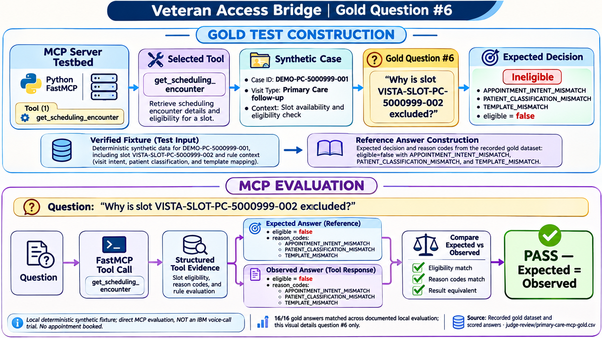

# Phoenix — Gold Questions & Security Controls

**Review checkpoint:** November 19, 2026. This page keeps *gold-answer matching* distinct from *deterministic local security control checks*. Phoenix grouped the saved suite results; these were **not 135 LLM-judged safety prompts**.

Fixture: DEMO-PC-5000999-001Tools: 4 evaluated in gold datasetModel judge: not claimed for deterministic matchingSource: recorded CSV artifacts

<strong>16 / 16</strong>Expected gold answers matched

<strong>135 / 135</strong>Local security &amp; control checks passed

<strong>6</strong>Grouped control suites

## 01 · Gold question design

Questions cover established/new classification, requested care, visit format and duration, eligible and excluded slots, wait-standard comparison, identity, and explicit missing-case denial. Several questions inspect fields from the same tool response, so 16 matched answers are **not 16 independent end-to-end bookings**.

**Example — Gold Question #6**

> Why is slot `VISTA-SLOT-PC-5000999-002` excluded?

| Decision item | Expected | Observed |
|---|---|---|
| Eligible | `false` | `false` |
| Reason 1 | `APPOINTMENT_INTENT_MISMATCH` | Matched |
| Reason 2 | `PATIENT_CLASSIFICATION_MISMATCH` | Matched |
| Reason 3 | `TEMPLATE_MISMATCH` | Matched |
| Recorded result | **PASS** | Expected = observed |

## 02 · Phoenix-grouped security and controls

| Suite | Checks passed | What it covered |
|---|---:|---|
| Trusted Primary Care | 47/47 | Host assertion, session/case scope, replay and persisted evidence |
| Protected Primary Care booking | 41/41 | Consent and booking grant, forged/expired assertion, recovery, no duplicate writes |
| Scheduling field contract | 14/14 | Field ownership and prevention of model-derived governed facts |
| CRM receipt | 12/12 | Receipt validation and authorized projections |
| Synthetic Veteran consent | 11/11 | Verified identity, case binding, and current consent |
| Booking CRM | 10/10 | Cross-call denial, idempotency, and valid note provenance |
| **Total** | **135/135** | **Six recorded, parameterized local test suites** |

**Security meaning:** These deterministic passing checks support a bounded implementation claim. They are not a penetration-test certification, comprehensive prompt-injection coverage, or proof that a separate Phoenix LLM judge independently verified each check.

## 03 · Source artifacts — find them in one place

- [Gold questions / expected answers](https://github.com/wbgreen0405/veteran-access-bridge/blob/ea0880f0cb216d5cc78601fdc85c40d37394e085/docs/evaluation/judge-review/primary-care-gold-questions.csv)
- [Expected vs. observed / 16 scored answers](https://github.com/wbgreen0405/veteran-access-bridge/blob/ea0880f0cb216d5cc78601fdc85c40d37394e085/docs/evaluation/judge-review/primary-care-mcp-gold.csv)
- [Six control suites / totals](https://github.com/wbgreen0405/veteran-access-bridge/blob/ea0880f0cb216d5cc78601fdc85c40d37394e085/docs/evaluation/judge-review/primary-care-control-suites.csv)
- [135 individual saved control checks](https://github.com/wbgreen0405/veteran-access-bridge/blob/ea0880f0cb216d5cc78601fdc85c40d37394e085/docs/evaluation/judge-review/control-results.csv)
- [November 19 judge-review explanation](https://github.com/wbgreen0405/veteran-access-bridge/blob/ea0880f0cb216d5cc78601fdc85c40d37394e085/docs/evaluation/judge-review/README.md)

**Next:** [IBM & DeepEval](agent-deepeval.md) · [Security & Adversarial Evaluation](security-adversarial.md)
