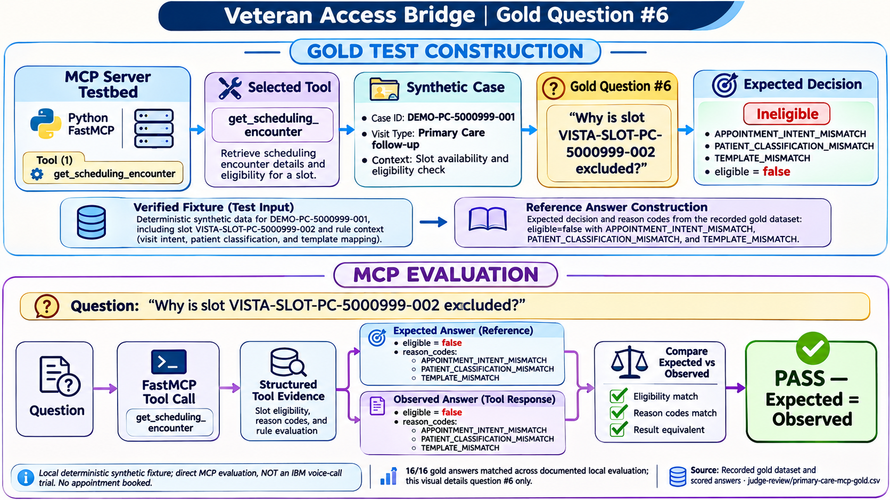

# Method & Gold Questions

How the evaluation was designed, from the October baseline to the **November 19** judge review. Gold-answer matching is kept separate from deterministic control checks; Phoenix grouped saved results and these were **not 135 LLM-judged safety prompts**.

<strong>16 / 16</strong>Gold answers matched<small>Primary Care fixture</small>

<strong>135 / 135</strong>Control checks passed<small>Deterministic, local</small>

<strong>6</strong>Grouped control suites<small>Phoenix-organized</small>

## Baseline (October to early November)

The foundation was a **10-question gold dataset**, synthetic encounter fixtures, MCP schema checks and failure cases. Historical analyzer failures are retained rather than converted to passes.

| Checkpoint | Recorded observation | Interpretation |
|---|---|---|
| October foundation | Ten-question gold dataset committed; MCP evaluation foundation merged | Provenance, not a 10/10 pass claim |
| M6.3 saved-agent run | 7/7 historical score; about 7.97 s average | Not a current M6.4 result |
| M6.3 direct run | Ten cases executed; six-case regression accepted with qualifications | Analyzer and text-match limits retained |
| M6.4 dataset | Thirteen designed scenarios | Dataset size is not a pass result |

## Gold question design

Questions cover established/new classification, requested care, visit format and duration, eligible and excluded slots, wait-standard comparison, identity, and explicit missing-case denial. Several questions read fields from the same tool response, so 16 matched answers are **not 16 independent end-to-end bookings**.

### Worked example: Gold Question #6

> Why is slot `VISTA-SLOT-PC-5000999-002` excluded?

| Decision item | Expected | Observed |
|---|---|---|
| Eligible | `false` | `false` |
| Reason 1 | `APPOINTMENT_INTENT_MISMATCH` | Matched |
| Reason 2 | `PATIENT_CLASSIFICATION_MISMATCH` | Matched |
| Reason 3 | `TEMPLATE_MISMATCH` | Matched |
| Recorded result | PASS | Expected = observed |

## Phoenix-grouped control checks

| Suite | Passed | What it covered |
|---|---:|---|
| Trusted Primary Care | 47/47 | Host assertion, session and case scope, replay, persisted evidence |
| Protected Primary Care booking | 41/41 | Consent and booking grant, forged or expired assertion, recovery, no duplicate writes |
| Scheduling field contract | 14/14 | Field ownership; no model-derived governed facts |
| CRM receipt | 12/12 | Receipt validation and authorized projections |
| Synthetic Veteran consent | 11/11 | Verified identity, case binding, current consent |
| Booking CRM | 10/10 | Cross-call denial, idempotency, note provenance |
| **Total** | **135/135** | **Six parameterized local suites** |

!!! warning "What this does not prove"
    These checks support a bounded implementation claim. They are not a penetration-test certification, comprehensive prompt-injection coverage, or independent verification by a Phoenix LLM judge.

## Source artifacts

- [Gold questions and expected answers](https://github.com/gsa-mcp-hackathon/veteran-access-bridge-mcp-server/blob/main/for-judges/engineering-records/docs/evaluation/judge-review/primary-care-gold-questions.csv)
- [Expected vs. observed, 16 scored answers](https://github.com/gsa-mcp-hackathon/veteran-access-bridge-mcp-server/blob/main/for-judges/engineering-records/docs/evaluation/judge-review/primary-care-mcp-gold.csv)
- [Six control suites and totals](https://github.com/gsa-mcp-hackathon/veteran-access-bridge-mcp-server/blob/main/for-judges/engineering-records/docs/evaluation/judge-review/primary-care-control-suites.csv)
- [135 individual saved control checks](https://github.com/gsa-mcp-hackathon/veteran-access-bridge-mcp-server/blob/main/for-judges/engineering-records/docs/evaluation/judge-review/control-results.csv)
- [November 19 judge-review explanation](https://github.com/gsa-mcp-hackathon/veteran-access-bridge-mcp-server/blob/main/for-judges/engineering-records/docs/evaluation/judge-review/README.md)
- [Submission evidence ledger](https://github.com/gsa-mcp-hackathon/veteran-access-bridge-mcp-server/blob/main/for-judges/engineering-records/docs/submission/evidence-ledger.md) · [Historical evaluation](https://github.com/gsa-mcp-hackathon/veteran-access-bridge-mcp-server/blob/main/for-judges/engineering-records/docs/submission/evaluation.md) · [M6.4 evaluation assets](https://github.com/gsa-mcp-hackathon/veteran-access-bridge-mcp-server/tree/main/eval/watsonx)

**Next:** [Validation & agent evidence](validation-agent.md)
