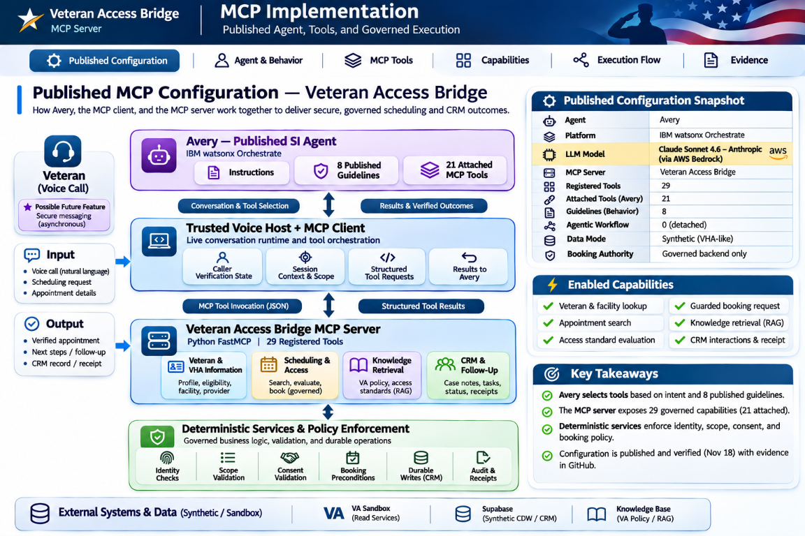

# MCP Implementation

**The MCP server is the primary deliverable.** Veteran Access Bridge uses Python FastMCP to expose structured scheduling capabilities while deterministic services enforce identity, case scope, consent, and protected booking rules.

VETERAN ACCESS BRIDGE · TECHNICAL IMPLEMENTATION

One governed tool server. Avery is one client—not the source of scheduling authority.

<strong>29</strong>Registered tools<small>Optional groups enabled</small>

<strong>21</strong>Attached to Avery<small>Reviewed configuration</small>

<strong>8</strong>Not attached to Avery<small>Restricted workflow path</small>

<nav class="vab-mcp-jump" aria-label="On this page"><a href="#published-configuration">Architecture</a><a href="#explore-the-registered-mcp-tools">Tool catalog</a><a href="#how-mcp-requests-are-governed">Governance</a><a href="#representative-mcp-contracts">Contracts</a></nav>

## Published configuration

*The existing architecture diagram is unchanged. Select it for the full-size image.*

## Explore the registered MCP tools

The catalog is a **static snapshot of the November 18, 2026 reviewed configuration**. The optional CRM and voice scheduling groups were enabled for the recorded 29-tool count; 21 tools were attached to Avery, and eight restricted handoff/control tools were intentionally excluded. Registration or attachment **does not authorize any patient read or booking**.

<label for="vab-tool-search">Search tools<input id="vab-tool-search" type="search" placeholder="Search tools or descriptions…" autocomplete="off"></label><label for="vab-tool-category">Capability<select id="vab-tool-category"><option value="all">All capabilities</option><option value="Access">Access</option><option value="Avery voice">Avery voice</option><option value="CRM">CRM</option><option value="Identity">Identity</option><option value="Lifecycle">Lifecycle</option><option value="Scheduling">Scheduling</option><option value="VA sandbox">VA sandbox</option></select></label><label for="vab-tool-attachment">Avery attachment<select id="vab-tool-attachment"><option value="all">All tools</option><option value="attached">Attached to Avery</option><option value="excluded">Not attached</option></select></label>

REGISTERED MCP TOOLS29 tools · reviewed configuration

01<code>verify_synthetic_identity</code><small>Identity</small>Attached to Avery⌄

Verify an approved synthetic caller against governed fixture data.

Included in the reviewed Avery tool attachment inventory. Attachment is not authorization.
<a href="https://github.com/gsa-mcp-hackathon/veteran-access-bridge-mcp-server/blob/main/src/veteran_access_bridge/mcp/tools/verify_synthetic_identity.py">View Python implementation on GitHub →</a>

02<code>determine_workflow_state</code><small>Scheduling</small>Attached to Avery⌄

Determine the case's workflow state using deterministic rules.

Included in the reviewed Avery tool attachment inventory. Attachment is not authorization.
<a href="https://github.com/gsa-mcp-hackathon/veteran-access-bridge-mcp-server/blob/main/src/veteran_access_bridge/mcp/tools/determine_workflow_state.py">View Python implementation on GitHub →</a>

03<code>search_availability</code><small>Scheduling</small>Attached to Avery⌄

Return normalized appointment availability for a synthetic case.

Included in the reviewed Avery tool attachment inventory. Attachment is not authorization.
<a href="https://github.com/gsa-mcp-hackathon/veteran-access-bridge-mcp-server/blob/main/src/veteran_access_bridge/mcp/tools/search_availability.py">View Python implementation on GitHub →</a>

04<code>assess_access_standard</code><small>Access</small>Attached to Avery⌄

Compare available care timing with the configured access standard.

Included in the reviewed Avery tool attachment inventory. Attachment is not authorization.
<a href="https://github.com/gsa-mcp-hackathon/veteran-access-bridge-mcp-server/blob/main/src/veteran_access_bridge/mcp/tools/assess_access_standard.py">View Python implementation on GitHub →</a>

05<code>check_community_care_eligibility</code><small>Access</small>Attached to Avery⌄

Return a bounded verification status; does not grant Community Care eligibility.

Included in the reviewed Avery tool attachment inventory. Attachment is not authorization.
<a href="https://github.com/gsa-mcp-hackathon/veteran-access-bridge-mcp-server/blob/main/src/veteran_access_bridge/mcp/tools/check_community_care_eligibility.py">View Python implementation on GitHub →</a>

06<code>get_case_lifecycle_state</code><small>Lifecycle</small>Attached to Avery⌄

Read the synthetic case lifecycle state and event history.

Included in the reviewed Avery tool attachment inventory. Attachment is not authorization.
<a href="https://github.com/gsa-mcp-hackathon/veteran-access-bridge-mcp-server/blob/main/src/veteran_access_bridge/mcp/tools/get_case_lifecycle_state.py">View Python implementation on GitHub →</a>

07<code>get_scheduling_encounter</code><small>Scheduling</small>Attached to Avery⌄

Read canonical scheduling evidence; does not book an appointment.

Included in the reviewed Avery tool attachment inventory. Attachment is not authorization.
<a href="https://github.com/gsa-mcp-hackathon/veteran-access-bridge-mcp-server/blob/main/src/veteran_access_bridge/mcp/tools/get_scheduling_encounter.py">View Python implementation on GitHub →</a>

08<code>prepare_scheduling_handoff</code><small>Lifecycle</small>Not attached⌄

Prepare a scheduling handoff review artifact; no booking.

Intentionally excluded from Avery in the reviewed inventory. Attachment is not authorization.
<a href="https://github.com/gsa-mcp-hackathon/veteran-access-bridge-mcp-server/blob/main/src/veteran_access_bridge/mcp/tools/prepare_scheduling_handoff.py">View Python implementation on GitHub →</a>

09<code>get_scheduling_handoff</code><small>Lifecycle</small>Not attached⌄

Read a prepared scheduling handoff artifact.

Intentionally excluded from Avery in the reviewed inventory. Attachment is not authorization.
<a href="https://github.com/gsa-mcp-hackathon/veteran-access-bridge-mcp-server/blob/main/src/veteran_access_bridge/mcp/tools/get_scheduling_handoff.py">View Python implementation on GitHub →</a>

10<code>validate_option_selection</code><small>Lifecycle</small>Not attached⌄

Check whether a proposed handoff option can be selected.

Intentionally excluded from Avery in the reviewed inventory. Attachment is not authorization.
<a href="https://github.com/gsa-mcp-hackathon/veteran-access-bridge-mcp-server/blob/main/src/veteran_access_bridge/mcp/tools/validate_option_selection.py">View Python implementation on GitHub →</a>

11<code>record_option_selection</code><small>Lifecycle</small>Not attached⌄

Record a scheduler selection in the restricted handoff path.

Intentionally excluded from Avery in the reviewed inventory. Attachment is not authorization.
<a href="https://github.com/gsa-mcp-hackathon/veteran-access-bridge-mcp-server/blob/main/src/veteran_access_bridge/mcp/tools/record_option_selection.py">View Python implementation on GitHub →</a>

12<code>prepare_veteran_confirmation_request</code><small>Lifecycle</small>Not attached⌄

Prepare a Veteran confirmation request artifact.

Intentionally excluded from Avery in the reviewed inventory. Attachment is not authorization.
<a href="https://github.com/gsa-mcp-hackathon/veteran-access-bridge-mcp-server/blob/main/src/veteran_access_bridge/mcp/tools/prepare_veteran_confirmation_request.py">View Python implementation on GitHub →</a>

13<code>record_veteran_confirmation</code><small>Lifecycle</small>Not attached⌄

Record the Veteran's response within the restricted confirmation flow.

Intentionally excluded from Avery in the reviewed inventory. Attachment is not authorization.
<a href="https://github.com/gsa-mcp-hackathon/veteran-access-bridge-mcp-server/blob/main/src/veteran_access_bridge/mcp/tools/record_veteran_confirmation.py">View Python implementation on GitHub →</a>

14<code>validate_booking_preconditions</code><small>Lifecycle</small>Not attached⌄

Check booking preconditions without committing a booking.

Intentionally excluded from Avery in the reviewed inventory. Attachment is not authorization.
<a href="https://github.com/gsa-mcp-hackathon/veteran-access-bridge-mcp-server/blob/main/src/veteran_access_bridge/mcp/tools/validate_booking_preconditions.py">View Python implementation on GitHub →</a>

15<code>record_lifecycle_event</code><small>Lifecycle</small>Not attached⌄

Record a governed synthetic lifecycle transition.

Intentionally excluded from Avery in the reviewed inventory. Attachment is not authorization.
<a href="https://github.com/gsa-mcp-hackathon/veteran-access-bridge-mcp-server/blob/main/src/veteran_access_bridge/mcp/tools/record_lifecycle_event.py">View Python implementation on GitHub →</a>

16<code>get_va_sandbox_health_facility</code><small>VA sandbox</small>Attached to Avery⌄

Read a facility record from the enabled VA sandbox adapter.

Included in the reviewed Avery tool attachment inventory. Attachment is not authorization.
<a href="https://github.com/gsa-mcp-hackathon/veteran-access-bridge-mcp-server/blob/main/src/veteran_access_bridge/mcp/tools/va_sandbox_readonly.py">View Python implementation on GitHub →</a>

17<code>search_va_sandbox_health_facilities</code><small>VA sandbox</small>Attached to Avery⌄

Search facility metadata through the enabled sandbox adapter.

Included in the reviewed Avery tool attachment inventory. Attachment is not authorization.
<a href="https://github.com/gsa-mcp-hackathon/veteran-access-bridge-mcp-server/blob/main/src/veteran_access_bridge/mcp/tools/va_sandbox_readonly.py">View Python implementation on GitHub →</a>

18<code>get_va_sandbox_health_facility_service</code><small>VA sandbox</small>Attached to Avery⌄

Read VA sandbox facility service details.

Included in the reviewed Avery tool attachment inventory. Attachment is not authorization.
<a href="https://github.com/gsa-mcp-hackathon/veteran-access-bridge-mcp-server/blob/main/src/veteran_access_bridge/mcp/tools/va_sandbox_readonly.py">View Python implementation on GitHub →</a>

19<code>get_va_community_care_case_summary</code><small>VA sandbox</small>Attached to Avery⌄

Read configured Community Care sandbox case context.

Included in the reviewed Avery tool attachment inventory. Attachment is not authorization.
<a href="https://github.com/gsa-mcp-hackathon/veteran-access-bridge-mcp-server/blob/main/src/veteran_access_bridge/mcp/tools/va_sandbox_readonly.py">View Python implementation on GitHub →</a>

20<code>get_va_patient_health_sandbox_summary</code><small>VA sandbox</small>Attached to Avery⌄

Read configured patient health sandbox summary data.

Included in the reviewed Avery tool attachment inventory. Attachment is not authorization.
<a href="https://github.com/gsa-mcp-hackathon/veteran-access-bridge-mcp-server/blob/main/src/veteran_access_bridge/mcp/tools/va_sandbox_readonly.py">View Python implementation on GitHub →</a>

21<code>get_va_clinical_health_case_summary</code><small>VA sandbox</small>Attached to Avery⌄

Read configured clinical health sandbox context.

Included in the reviewed Avery tool attachment inventory. Attachment is not authorization.
<a href="https://github.com/gsa-mcp-hackathon/veteran-access-bridge-mcp-server/blob/main/src/veteran_access_bridge/mcp/tools/va_sandbox_readonly.py">View Python implementation on GitHub →</a>

22<code>get_crm_case</code><small>CRM</small>Attached to Avery⌄

Read scoped synthetic CRM case details.

Included in the reviewed Avery tool attachment inventory. Attachment is not authorization.
<a href="https://github.com/gsa-mcp-hackathon/veteran-access-bridge-mcp-server/blob/main/src/veteran_access_bridge/mcp/tools/crm.py">View Python implementation on GitHub →</a>

23<code>record_crm_interaction</code><small>CRM</small>Attached to Avery⌄

Write a governed CRM interaction record.

Included in the reviewed Avery tool attachment inventory. Attachment is not authorization.
<a href="https://github.com/gsa-mcp-hackathon/veteran-access-bridge-mcp-server/blob/main/src/veteran_access_bridge/mcp/tools/crm.py">View Python implementation on GitHub →</a>

24<code>create_crm_follow_up</code><small>CRM</small>Attached to Avery⌄

Create a governed CRM follow-up item.

Included in the reviewed Avery tool attachment inventory. Attachment is not authorization.
<a href="https://github.com/gsa-mcp-hackathon/veteran-access-bridge-mcp-server/blob/main/src/veteran_access_bridge/mcp/tools/crm.py">View Python implementation on GitHub →</a>

25<code>update_crm_follow_up</code><small>CRM</small>Attached to Avery⌄

Update a governed CRM follow-up item.

Included in the reviewed Avery tool attachment inventory. Attachment is not authorization.
<a href="https://github.com/gsa-mcp-hackathon/veteran-access-bridge-mcp-server/blob/main/src/veteran_access_bridge/mcp/tools/crm.py">View Python implementation on GitHub →</a>

26<code>search_call_appointments</code><small>Avery voice</small>Attached to Avery⌄

Search appointment options within a trusted voice call.

Included in the reviewed Avery tool attachment inventory. Attachment is not authorization.
<a href="https://github.com/gsa-mcp-hackathon/veteran-access-bridge-mcp-server/blob/main/src/veteran_access_bridge/mcp/tools/voice_workflow.py">View Python implementation on GitHub →</a>

27<code>select_call_appointment</code><small>Avery voice</small>Attached to Avery⌄

Select a call-scoped appointment option, not a booking.

Included in the reviewed Avery tool attachment inventory. Attachment is not authorization.
<a href="https://github.com/gsa-mcp-hackathon/veteran-access-bridge-mcp-server/blob/main/src/veteran_access_bridge/mcp/tools/voice_workflow.py">View Python implementation on GitHub →</a>

28<code>book_call_appointment</code><small>Avery voice</small>Attached to Avery⌄

Request a protected synthetic booking subject to trusted authority checks.

Included in the reviewed Avery tool attachment inventory. Attachment is not authorization.
<a href="https://github.com/gsa-mcp-hackathon/veteran-access-bridge-mcp-server/blob/main/src/veteran_access_bridge/mcp/tools/voice_workflow.py">View Python implementation on GitHub →</a>

29<code>search_call_knowledge</code><small>Avery voice</small>Attached to Avery⌄

Retrieve call-bound supporting knowledge without granting authority.

Included in the reviewed Avery tool attachment inventory. Attachment is not authorization.
<a href="https://github.com/gsa-mcp-hackathon/veteran-access-bridge-mcp-server/blob/main/src/veteran_access_bridge/mcp/tools/voice_workflow.py">View Python implementation on GitHub →</a>

No matching tools. Try a different search or filter.

<button id="vab-tool-more" type="button" hidden aria-controls="vab-tool-list">Show all 29 tools</button>Catalog is built into the page · no API calls

<small>Source: [reviewed tool inventory and attachment reconciliation](https://github.com/gsa-mcp-hackathon/veteran-access-bridge-mcp-server/blob/main/release/evidence/guidelines-and-tool-inventory-20261118.md). Without JavaScript, all 29 tool rows remain readable. This inventory does not imply all optional capabilities are active in every environment.</small>

## How MCP requests are governed

<strong>01 · Avery requests</strong>
An agent selects an attached MCP tool and supplies allowed parameters.

<strong>02 · Server verifies</strong>
Trusted infrastructure checks transport authentication and case scope.

<strong>03 · Backend decides</strong>
Deterministic services enforce relevant consent, eligibility, slot freshness and booking authority rules.

<strong>04 · Evidence is returned</strong>
A structured result or explicit denial returns. Protected synthetic writes require independent persisted evidence.

See [Security & Governance](security-governance.md) and [Solution & Architecture](solution-architecture.md) for details.

## Representative MCP contracts

| Tool | Core input | Behavior / limitation |
|---|---|---|
| `get_scheduling_encounter` | `case_id` | Read-only scheduling evidence; no booking |
| `assess_access_standard` | `case_id` | Deterministic wait comparison; not Community Care authorization |
| `search_availability` | `case_id` | Normalized options; no handoff write |
| `search_call_appointments` | Call-scoped preferences | Returns options; no booking |
| `select_call_appointment` | Selected option | Selection for readback; not consent |
| `book_call_appointment` | Trusted call context | Protected booking request, subject to current confirmation and policy |
| `search_call_knowledge` | Scoped query | Grounded retrieval; cannot elevate privilege |

**Next:** [Run the MCP server in VS Code](developer-guide/vs-code.md) · [Review evaluation evidence](evaluation/index.md) · [Browse source registrations](https://github.com/gsa-mcp-hackathon/veteran-access-bridge-mcp-server/tree/main/src/veteran_access_bridge/mcp/tools)
