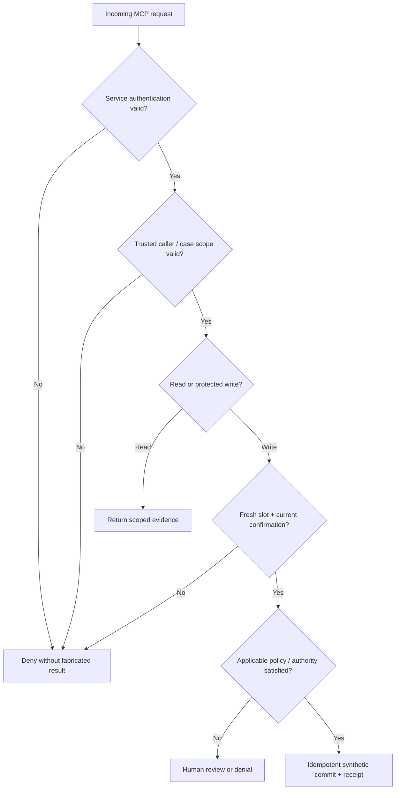

# Security & Governance

> **The LLM is not the security boundary.**

Avery can select a relevant MCP tool and request an action. The trusted server and host independently decide whether the caller, case, consent, slot and service policy authorize it. **All appointment writes in this project are synthetic.**

## Governing a tool request

## Critical controls

| Control | Enforcement |
|---|---|
| Identity / session binding | Trusted host verifies synthetic caller and binds room, participant, case and time scope. |
| Credential versus authority | An MCP bearer token or reviewer login is **not** booking permission. |
| Current confirmation | Option selection != caller confirmation != persisted booking. |
| Policy and Community Care | A wait-time threshold is a review signal, **not** Community Care eligibility/authorization. |
| Routine internal Primary Care | A separate, trusted scoped service-policy grant may permit synthetic booking after caller confirmation; not every path needs manual scheduler approval. |
| Database writes | RLS/restricted roles, idempotency keys, receipts and independent post-write validation. |
| Knowledge/retrieval | Untrusted KB text cannot grant consent, identity, signing material or authority. |
| Client security | Browser sees authorized projections; privileged MCP and database credentials are never exposed. |

## Adversarial verification

The November 16 server evaluation reported **76/76 hostile argument probes** and **261/261 scope/schema assertions** in its documented configuration. These are bounded checks; they do not establish comprehensive penetration-test or production compliance certification.

A model attempting a prohibited operation must receive server-level denial rather than reliance on prompt obedience. See [adversarial scope tests](https://github.com/wbgreen0405/veteran-access-bridge/blob/5b6cd072f23b4d4edce2e19c4f75faa774c87988/tests/test_mcp_scope_adversarial.py) and [November 16 evaluation](https://github.com/wbgreen0405/veteran-access-bridge/blob/5b6cd072f23b4d4edce2e19c4f75faa774c87988/docs/evaluation/server-wide-evaluation-20261116.md).

## Boundaries and open work

The acceptance record proves one synthetic scheduling journey at one revision. Broader database concurrency, recovery of uncertain writes, cross-MCP injection, poisoning/SSRF and dependency follow-up remain independently documented open areas. Masked text captions are not an audio-retention guarantee. Do not infer HIPAA accreditation, VA production approval or general attack resistance.

[Security follow-up](https://github.com/wbgreen0405/veteran-access-bridge/blob/5b6cd072f23b4d4edce2e19c4f75faa774c87988/docs/evaluation/security-followup-20261115.md) · [Acceptance evidence](evaluation-results.md) · [Architecture](solution-architecture.md)
