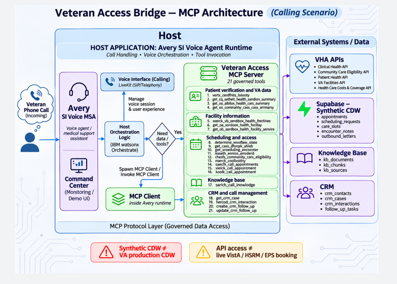
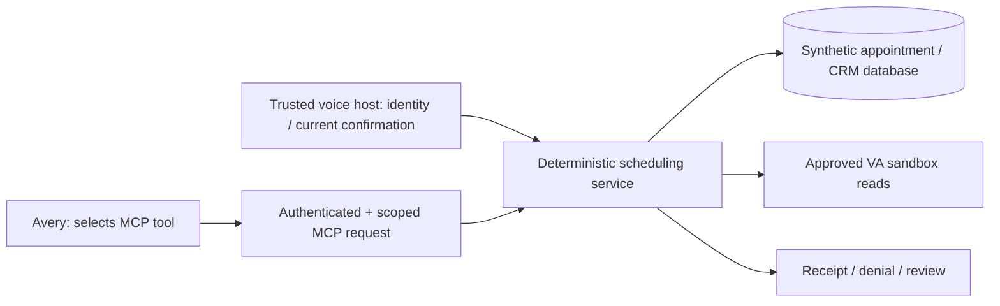

# Solution & Architecture

**A governed MCP server for Veteran healthcare scheduling**

Veteran Access Bridge connects **Avery**, an SI voice agent using IBM watsonx Orchestrate, to structured scheduling tools and trusted backend services. The **MCP server is the primary hackathon deliverable**; Avery demonstrates how an SI agent uses it during a synthetic Veteran healthcare call.

## Calling-scenario architecture

*[Open full-size original architecture diagram](assets/architecture-calling-scenario.png). This preserved diagram describes an earlier **21-tool calling-scenario inventory**. The independently reviewed November 18 configuration had **29 registered tools** when optional features were enabled, with **21 MCP attachments on Avery**. Counts from different versions are not interchangeable.*

## What each layer does

| Component | Responsibility |
|---|---|
| **Browser and LiveKit voice host** | Caller audio and scoped interface. Trusted host handles verified participant/session context and current confirmation. |
| **Avery · IBM watsonx Orchestrate** | Conversational coordination; selects MCP tools and responds using returned evidence. |
| **Veteran Access Bridge · Python FastMCP** | Typed tool schemas, authentication, case/identity scope, validated requests and structured results. |
| **Deterministic services** | Eligibility, access standards, ranking, appointment selection, consent/policy gates, idempotent commits. |
| **VHA sandbox adapters** | Configured read-only government sandbox interfaces; not production VistA/HSRM/EPS booking. |
| **Supabase PostgreSQL / synthetic CDW** | Simulated appointment and CRM state, restricted writes, record-backed receipts. |
| **Knowledge / RAG** | Retrieval of supporting content; retrieved text is evidence, never authority. |

## Engineering decisions

<strong>Normalize before SI</strong>
Canonical encounter data, explicit source provenance and typed tool outputs.

<strong>Policy as code</strong>
Eligibility and access-standard checks run in deterministic backend services.

<strong>Authority outside the LLM</strong>
Identity, consent, scope and booking rights cannot be issued by model prose.

<strong>Auditable writes</strong>
Persisted receipts and independent reads distinguish a completed booking from a spoken claim.

## Trust-boundary detail

**Core principle:** SI can request an operation. Only trusted services determine whether it is valid, permitted and committed. Routine scoped internal Primary Care service policy and Community Care human-review paths are intentionally distinct.

## Evidence

A November 16 controlled RTC call selected five IBM MCP tool types and reached one independently verified **synthetic appointment**, one **host-written CRM note**, and a `BOOKED_SIMULATED` receipt. This proof belongs to the recorded revision, not to an assumed later build.

[Historical booking acceptance](https://github.com/wbgreen0405/veteran-access-bridge/blob/5b6cd072f23b4d4edce2e19c4f75faa774c87988/docs/operations/avery-agent-led-scheduling-20261116.md) · [Machine-readable evidence](https://github.com/wbgreen0405/veteran-access-bridge/blob/5b6cd072f23b4d4edce2e19c4f75faa774c87988/docs/evaluation/agent-led-voice-20261116.json) · [MCP Implementation](mcp-implementation.md)

<small>Synthetic technical demonstration only. Diagram shows a historical design, not proof of production VA data access or authorization.</small>
