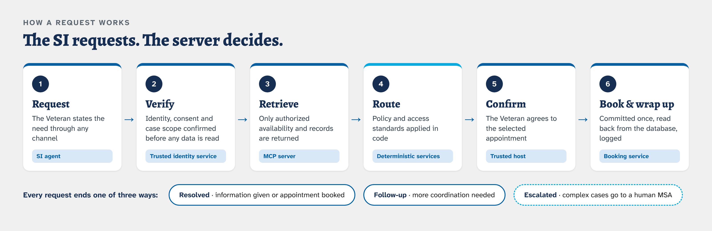

# 01 · Problem and solution

**Use case:** Veteran Access Bridge is a secured MCP server that gives any Super Intelligent (SI) agent 29 validated tools to look up VA health summaries, search open slots and book appointments for Veterans. The IBM watsonx Orchestrate voice agent Avery uses those tools to complete a booking in a single conversation.

**Track:** Service: Read and Write

## Problem statement

**Problem:** Scheduling VA care takes too many steps across too many systems. VA needs a simpler way to schedule without compromising security, accuracy or staff oversight.

*Sources: [GAO-26-109213](https://www.gao.gov/products/gao-26-109213) (June 2026); [GAO-24-107112](https://www.gao.gov/products/gao-24-107112) (November 2023).*

## Proposed solution

**Solution:** Veteran Access Bridge is a governed MCP server that lets SI agents schedule VA care in a single conversation. The agent handles the request. The server verifies the Veteran, checks the rules and confirms each booking in the database. Staff stay in control of complex cases.

The server does not depend on the channel. Voice is the first channel built; secure messaging, chat and other channels can use the same tools and the same controls.

**Core principle:** *SI requests; the server decides.* A tool call, a case ID supplied by the model or an agent saying "you're all set" never counts as authorization or as proof of a booking.

### Components

| Component | Role | Holds authority? |
|---|---|---|
| **Avery** (IBM watsonx Orchestrate) | The first SI agent client, on a voice channel. Talks with the Veteran, chooses MCP tools, explains results | No |
| **Veteran Access MCP Server** (Python FastMCP) | Exposes 29 typed tools in four groups; authenticates and scopes every request | Yes: scope |
| **Deterministic services** | Enforce identity, consent, eligibility, slot and booking rules in code | Yes: decisions |
| **VHA APIs + Supabase** | Read-only VA sandbox data; synthetic appointments, consent and CRM records | Enforces database access |
| **Human MSA review** | Handles escalations and the review handoff path | Yes: judgment |

### How a request works

Each request ends in one of three ways: **resolved** (information given or appointment booked), **follow-up** (more coordination needed) or **escalated** (sent to a human MSA).

### What the server provides

| Tool group | Tools | Access |
|---|---|---|
| VHA APIs | 6 | Read-only, VA sandbox |
| Scheduling | 18 (15 core + 3 voice) | Read and governed write |
| CRM | 4 | Read and write |
| Knowledge base | 1 | Retrieval |

Of the 29 tools, 21 are attached to Avery. The other 8 make up the human-review handoff path and are deliberately kept away from the agent. 10 tools write records (booking, slot selection, confirmations, handoffs and CRM notes), and each write is gated by trusted services. See [Section 02](../02-architecture/README.md) for the full list.

### Scope for this hackathon

- **Channels:** voice demonstrated end to end; built to extend to secure messaging and chat.
- **Care areas:** Primary Care demonstrated end to end; built to extend to Specialty Care, Community Care, Care Coordination and Mental Health.
- **Out of scope:** production VA systems, real Veteran data and live appointment writes. All data is synthetic.

### Success criteria

| Criterion | Measure | Result |
|---|---|---|
| The agent completes a booking on one call | Booking confirmed by database readback | Met: Dec 4, 2026, 9:00 AM CST ([Section 03](../03-demonstration/README.md)) |
| The server gives correct answers | Known-answer and rule checks | Met: 16/16 gold answers, 135/135 rule checks |
| Every tool resists bad and hostile input | Contract and adversarial probes | Met: 126/126 and 86/86, all 29 tools |
| The deployed server enforces caller scope | Protected reads without a verified caller | Met: 18/18 denied (Nov 23, hosted) |
| Production security acceptance | Deployed adversarial scenarios | Not yet met: 4 items PARTIAL ([Section 05](../05-security/README.md)) |

**Next:** [02 · Architecture →](../02-architecture/README.md)
