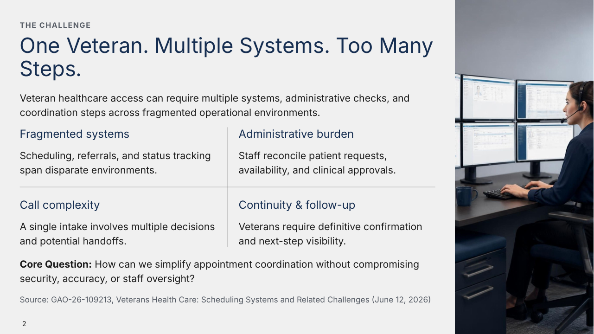
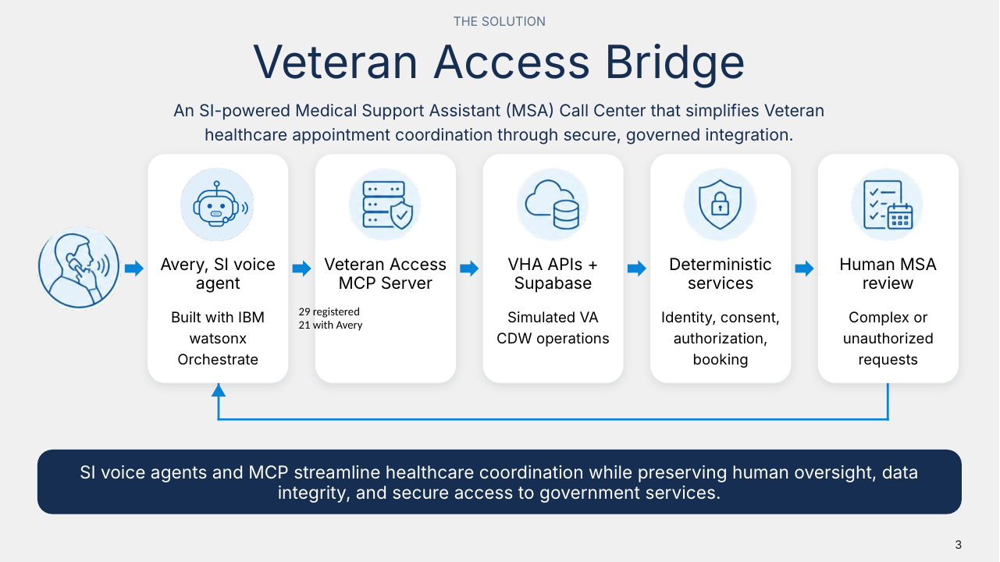
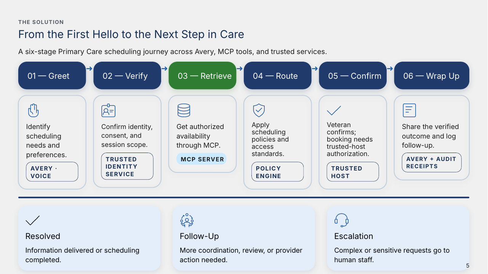
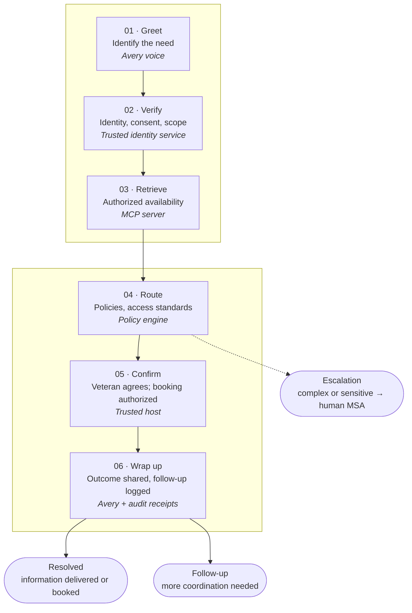
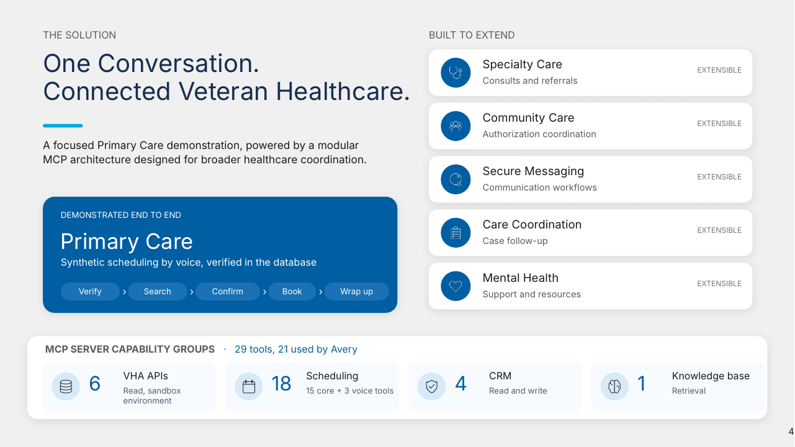

# 01 · Problem and solution

> **Use case:** Veteran Access Bridge is a secured MCP server that gives any SI agent 29 validated tools to look up VA health summaries, search open slots and book appointments for Veterans. The IBM watsonx Orchestrate voice agent Avery uses those tools to complete a booking on a single call.
>
> **Track:** Service: Write · **Presentation:** slides 2–5

---

## Problem statement

**One Veteran. Multiple systems. Too many steps.**

Veteran healthcare access can require multiple systems, administrative checks and coordination steps across fragmented operational environments. Scheduling, referrals and status tracking span disparate environments. Staff must reconcile each patient request against availability and clinical approvals. A single intake involves multiple decisions and potential handoffs, and at the end of it the Veteran still needs a definitive confirmation and visibility into the next step.

**The problem this submission addresses:** how to simplify appointment coordination **without compromising security, accuracy or staff oversight.**

*Source: GAO-26-109213, Veterans Health Care: Scheduling Systems and Related Challenges (June 12, 2026).*

## The solution: an SI-powered MSA call center on a governed MCP server

Veteran Access Bridge is an **SI-powered Medical Support Assistant (MSA) call center** that simplifies appointment coordination through secure, governed integration. Five parts work together, and only some of them hold authority:

| Part | What it does | Holds authority? |
|---|---|---|
| **Avery, SI voice agent** (IBM watsonx Orchestrate) | Talks with the Veteran, chooses MCP tools, explains results | No |
| **Veteran Access MCP Server** (Python FastMCP, 29 registered tools, 21 used by Avery) | Exposes typed tools; authenticates and scopes every call | Yes, scope |
| **VHA APIs + Supabase** | Read-only VA sandbox data plus simulated VA CDW operations (appointments, consent, CRM) | Enforces database access |
| **Deterministic services** | Identity, consent, authorization and booking rules in server code | **Yes, decisions** |
| **Human MSA review** | Handles complex or unauthorized requests | **Yes, judgment** |

**Core principle:** *SI requests tools; trusted deterministic backend services determine what is valid, permitted and committed.* A tool call, a case ID the model supplies, or a spoken "you're all set" is never treated as authorization or as proof of a booking.

## The caller's journey: six stages, three outcomes

Every call ends in one of three ways: **Resolved** (information delivered or scheduling completed), **Follow-up** (more coordination, review or provider action needed) or **Escalation** (complex or sensitive requests go to human staff). Escalation is a designed path, not a failure: the agent is not allowed to decide cases that belong to a person.

## Built to extend: Primary Care first, the same server for more

The submission demonstrates **Primary Care end to end**: synthetic scheduling by voice, verified in the database (Verify → Search → Confirm → Book → Wrap up). The MCP server is modular, so the same pattern extends to Specialty Care (consults and referrals), Community Care (authorization coordination), Secure Messaging, Care Coordination (case follow-up) and Mental Health (support and resources).

The server's **29 tools are organized in four capability groups**:

| Group | Tools | Access | Used by Avery |
|---|---|---|---|
| **VHA APIs** | 6 | Read, sandbox environment | 6 |
| **Scheduling** | 18 (15 core + 3 voice) | Read and governed write | 10 |
| **CRM** | 4 | Read and write | 4 |
| **Knowledge base** | 1 | Retrieval | 1 |
| **Total** | **29** | | **21** |

## Why this is a Service: Write entry

The server's main job is completing actions safely. **10 of the 29 tools change records**, and every one of them is gated by trusted services:

| Write tool | Group | What it changes |
|---|---|---|
| `select_call_appointment` | Scheduling (voice) | Records which offered slot the caller chose (not a booking) |
| `book_call_appointment` | Scheduling (voice) | Requests a protected synthetic booking, subject to identity, consent, slot and policy checks |
| `record_option_selection` | Scheduling (core) | Records a scheduler's selection in the human-review handoff path |
| `prepare_scheduling_handoff` | Scheduling (core) | Creates a handoff artifact for human review |
| `prepare_veteran_confirmation_request` | Scheduling (core) | Prepares a confirmation request for the Veteran |
| `record_veteran_confirmation` | Scheduling (core) | Records the Veteran's confirmation |
| `record_lifecycle_event` | Scheduling (core) | Records a governed case lifecycle transition |
| `record_crm_interaction` | CRM | Writes a CRM interaction note |
| `create_crm_follow_up` | CRM | Creates a CRM follow-up item |
| `update_crm_follow_up` | CRM | Updates a CRM follow-up item |

On November 21 every write tool was called with forged authority, and every call was refused with no change to the database (part of 86/86; see [Section 04](../04-evaluation/README.md)).

## What we proved

| Claim | Evidence |
|---|---|
| An SI agent can book through the server on one call | Final demo call: Primary Care, Fri Dec 4, 2026, 9:00 AM CST, confirmed by database readback ([Section 03](../03-demonstration/README.md)) |
| The server gives correct answers | 16/16 gold answers, 135/135 rule checks, 1,630 automated tests (Nov 19) |
| Every tool behaves correctly under bad input | 126/126 contract checks, 86/86 hostile-argument checks on all 29 tools (Nov 21) |
| The deployed server enforces caller scope | 18/18 protected reads denied without a verified caller session (Nov 23, hosted) |

## Scope

All data is synthetic. VA interfaces are read-only sandbox adapters; appointments and CRM records live in a synthetic Supabase database, not in VistA, HSRM or any production VA system. No production booking, time-savings or security-certification claim is made. Open items are listed in the [package index](../README.md#known-limitations-not-claimed).

**Next:** [02 · Architecture →](../02-architecture/README.md)
