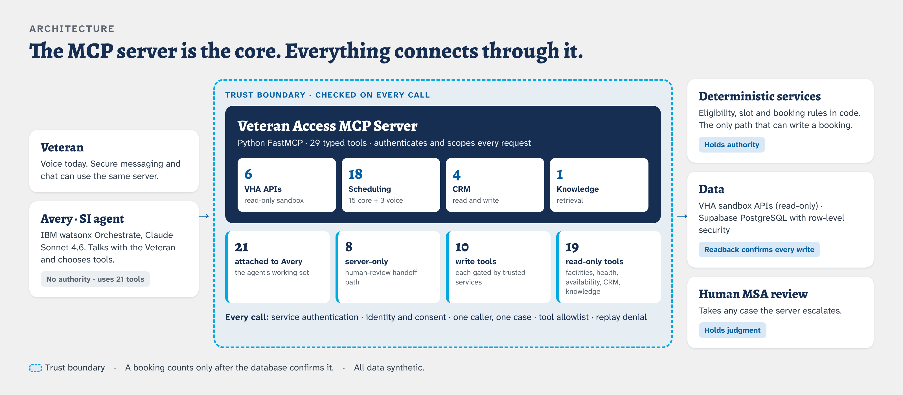
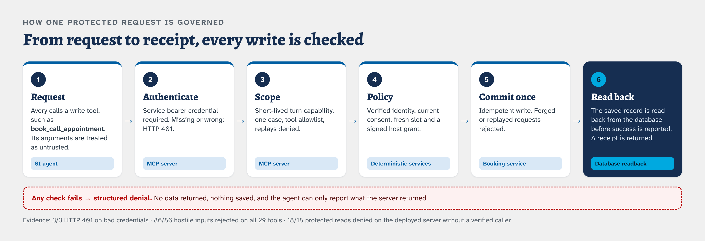

# 02 · MCP architecture

**Architecture:** The MCP server is the core of Veteran Access Bridge, and everything else connects through it. It exposes 29 typed tools and checks identity, consent and scope on every call. Avery, the SI agent, uses 21 of those tools to talk with the Veteran, but holds no authority. The other 8 are kept on the server for the human-review handoff. Trusted backend services enforce the scheduling rules and are the only part that can write a booking. The VHA sandbox APIs and Supabase hold the data, and human MSAs take any case the server escalates. A booking counts only after the database confirms it.

## Architecture overview

| Layer | Technology | Responsibility | Holds authority? |
|---|---|---|---|
| Voice | LiveKit, Deepgram | Real-time browser audio and speech recognition | No |
| Trusted voice host | LiveKit voice worker and trusted backend | Verifies spoken identity, binds the call to one case, captures current confirmation | **Yes**, identity and confirmation |
| SI agent | IBM watsonx Orchestrate, Avery, 8 behavior guidelines | Runs the conversation, chooses tools, explains results | No |
| MCP server | Python FastMCP | Typed schemas, bearer authentication, case and session scope, structured results or denials | **Yes**, scope |
| Deterministic services | Python services | Eligibility, access standards, slot matching, consent and booking rules, idempotent commits | **Yes**, decisions |
| VHA interfaces | VA sandbox adapters | Facility directory and health-summary context; no live VA access | No (read-only) |
| Data | Supabase PostgreSQL | Synthetic appointments, consent, audit events, CRM; restricted roles, forced row-level security | Enforces DB access |
| Hosting | IBM Code Engine | Containerized backend and voice worker | n/a |

## How one protected request is governed

A failed check at any step returns a **structured denial**, never model prose and never partial data. The server fails closed.

## The 29 tools by capability group

| Group | Tools | Attached to Avery | Write tools |
|---|---|---|---|
| **VHA APIs** (6, read-only) | `get_va_sandbox_health_facility`, `search_va_sandbox_health_facilities`, `get_va_sandbox_health_facility_service`, `get_va_community_care_case_summary`, `get_va_patient_health_sandbox_summary`, `get_va_clinical_health_case_summary` | 6 of 6 | 0 |
| **Scheduling, core** (15) | `verify_synthetic_identity`, `determine_workflow_state`, `search_availability`, `get_scheduling_encounter`, `assess_access_standard`, `check_community_care_eligibility`, `get_case_lifecycle_state`, `prepare_scheduling_handoff`, `get_scheduling_handoff`, `validate_option_selection`, `record_option_selection`, `prepare_veteran_confirmation_request`, `record_veteran_confirmation`, `validate_booking_preconditions`, `record_lifecycle_event` | 7 of 15 | 5 |
| **Scheduling, voice** (3) | `search_call_appointments`, `select_call_appointment`, `book_call_appointment` | 3 of 3 | 2 |
| **CRM** (4) | `get_crm_case`, `record_crm_interaction`, `create_crm_follow_up`, `update_crm_follow_up` | 4 of 4 | 3 |
| **Knowledge base** (1) | `search_call_knowledge` | 1 of 1 | 0 |
| **Total** | **29** | **21** | **10** |

**Why 8 tools are not attached to Avery.** The eight unattached tools are the human-review handoff path: preparing a handoff, validating and recording a scheduler's selection, preparing and recording a Veteran confirmation, checking booking preconditions and recording lifecycle events. Keeping them off the voice agent means the agent cannot complete a step that belongs to a person.

**Registered versus advertised.** The default local configuration advertises 21 tools. Turning on the optional CRM and agent-scheduling groups (`VAB_ENABLE_CRM`, `VAB_ENABLE_AGENT_SCHEDULING`) registers all 29. The hosted M6.4 server presented all 29 on November 23 (29/29 catalog and schema checks).

Full catalog with descriptions and source links: [MCP implementation](../../docs/mcp-implementation.md).

## Technical approach and key decisions

**Four principles**

| Principle | How it is implemented |
|---|---|
| **Normalize before SI** | Canonical case states, access options, source provenance and strict input validation standardize scheduling data before the model reasons over it |
| **Policy as code** | Wait-time standards, clinical eligibility and Community Care criteria are evaluated in server code, not prompts. An access-standard breach is a review signal, never autonomous authorization |
| **Authority outside the LLM** | Caller identity, session consent, case scope and booking commits are enforced by the trusted host. A generated sentence cannot approve a database commit |
| **Durable, auditable writes** | Restricted Supabase connections, forced row-level security, idempotency keys and transactional audit receipts. Saved state is verified independently of model claims |

**Seven technology choices**

| Choice | Why |
|---|---|
| Model Context Protocol | Standard, discoverable integration any SI agent can use |
| IBM watsonx Orchestrate | Managed SI agent development, tool attachment and evaluation |
| VHA APIs | Real government service interfaces, used read-only in the sandbox |
| Supabase | Synthetic CDW and operational data with relational integrity and RLS |
| Synthetic data | Safe, reproducible testing with no real Veteran information |
| Deterministic controls | Security and accountability that do not depend on model behavior |
| DeepEval and automated testing | Measurable reliability, graded by independent judges |

## Source map

| Path | Contents |
|---|---|
| [`src/veteran_access_bridge/mcp/app.py`](../../src/veteran_access_bridge/mcp/app.py) | FastMCP server and tool registration |
| [`src/veteran_access_bridge/mcp/tools/`](../../src/veteran_access_bridge/mcp/tools) | Tool implementations |
| [`src/veteran_access_bridge/mcp/session_scope.py`](../../src/veteran_access_bridge/mcp/session_scope.py) | Turn capabilities, case binding, tool allowlists |
| [`src/veteran_access_bridge/services/`](../../src/veteran_access_bridge/services) | Deterministic eligibility, slot matching and policy |
| [`db/`](../../db) | Synthetic database schema and RLS setup |
| [`frontend/`](../../frontend/SNAPSHOT.md) | Companion browser app (release snapshot) |

**Read more:** [Solution and architecture](../../docs/solution-architecture.md) · [Engineering decisions](../../docs/developer-guide/engineering-decisions.md) · [Security and governance](../../docs/security-governance.md)

**Next:** [03 · Demonstration →](../03-demonstration/README.md)
