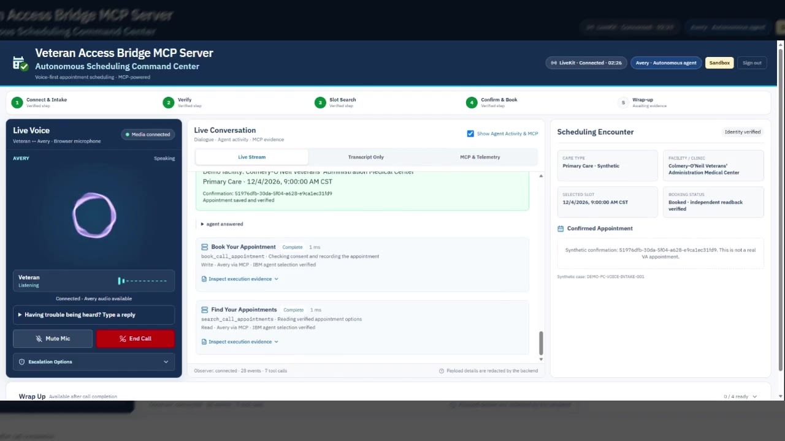
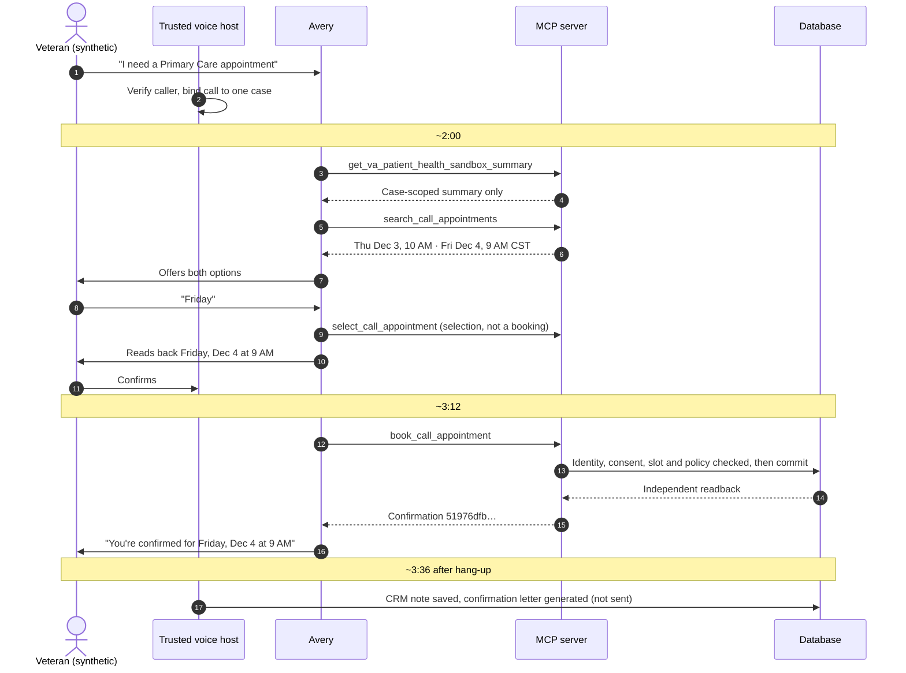
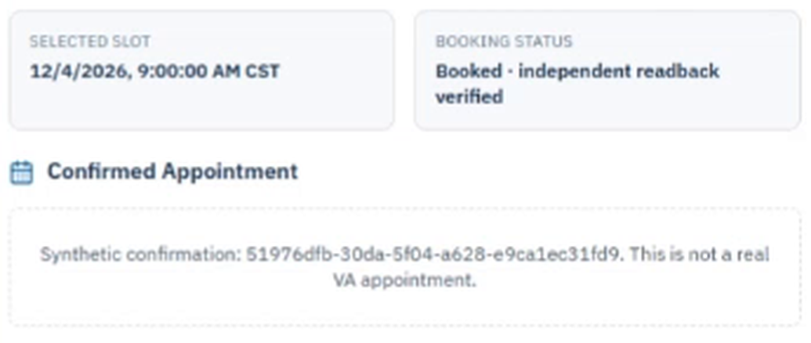

# 03 · Demonstration

> **[Watch the recorded call (MP4, 3:39)](../../docs/assets/avery-demo.mp4)** · [Interactive walkthrough](../../docs/demonstration.md)

---

## The call at a glance

| | |
|---|---|
| **Caller** | Synthetic Veteran, case `DEMO-PC-VOICE-INTAKE-001` |
| **Request** | Schedule a Primary Care appointment |
| **Agent** | Avery, IBM watsonx Orchestrate, Claude Sonnet 4.6 |
| **Outcome** | Primary Care, **Friday, December 4, 2026, 9:00 AM CST**, Colmery-O'Neil VA Medical Center |
| **Proof** | Synthetic confirmation `51976dfb-30da-5f04-a628-e9ca1ec31fd9`, confirmed by independent database readback |
| **Tool calls** | 7 in total. IBM selected 4 MCP tools: `get_va_patient_health_sandbox_summary`, `search_call_appointments`, `select_call_appointment`, `book_call_appointment` |

## What happened, in order

| # | Stage | What happens | Who decides |
|---|---|---|---|
| 1 | Greet | The caller asks for Primary Care. This starts the conversation and grants nothing. | n/a |
| 2 | Verify | The trusted voice host verifies the caller and binds the call to one case. The model cannot assert identity. | Trusted voice host |
| 3 | Retrieve (~2:00) | Avery reads the permitted, case-scoped health summary. | MCP server scope check |
| 4 | Search and select | Two verified openings are offered; the caller picks Friday. Selecting is not booking. | Deterministic slot services |
| 5 | Confirm | The selected time is read back; the caller gives a separate, current confirmation. | Trusted voice host |
| 6 | Book (~3:12) | Trusted services check identity, consent, slot and policy, commit once, and read the record back before success is reported. | Deterministic booking service |
| 7 | Wrap up (~3:36) | After hang-up, the trusted booking service saves a CRM note and generates a confirmation letter (not sent). | Trusted booking service |

## Don't just trust the response. Verify the result.

The same booking is checked three independent ways.

**1 · Voice session.** Avery confirms the appointment after the caller agrees (final LiveKit caption).

**2 · MCP tool trace.** IBM watsonx Orchestrate selected `book_call_appointment`, a write through the MCP server; the call made 7 tool calls in total, with payloads redacted by the backend.

**3 · Verified state.** The database readback shows the slot booked and independently verified. Synthetic confirmation `51976dfb-30da-5f04-a628-e9ca1ec31fd9`; not a real VA appointment.

**Also verified (Nov 16, CRM):** 2 IBM-selected reads, 3 writes and 3 matching database audit receipts.

## What to watch for in the video

- **Verification comes before any patient data.** The health-summary read happens only after the trusted host binds the caller to the case.
- **The agent offers only what the server returned.** Both times come from `search_call_appointments`; Avery does not invent slots.
- **"Confirmed" is said only after readback.** The confirmation number comes from the database record.
- **After-call work is done by the trusted service, not the agent.**

## Earlier accepted trial (November 16)

A separate controlled call (case `CASE-047`, backend revision 00037) selected five IBM tool types and reached one independently verified synthetic appointment, one host-written CRM note and a `BOOKED_SIMULATED` receipt. It is its own record and does not validate later releases.

[Nov 16 acceptance record](../engineering-records/docs/operations/avery-agent-led-scheduling-20261116.md) · [Nov 16 evidence JSON](../engineering-records/docs/evaluation/agent-led-voice-20261116.json)

## What this demonstration does not show

- One synthetic call; it is not a load or repeatability test.
- No attack is shown in the video. Adversarial results are in [Section 04](../04-evaluation/README.md) and [Section 05](../05-security/README.md).
- On the November 23 hosted evaluation run, a second end-to-end Avery call stopped at identity verification before any patient read (see [Section 04](../04-evaluation/README.md#hosted-evaluation-november-23)). The demonstration call above is the completed end-to-end evidence.
- The confirmation letter is generated but not sent; no production VA system is touched. Do not replay this booking: the synthetic slot and case are consumed.

**Try it without a voice setup:** [Section 06](../06-reproducibility/README.md) runs the same server locally in about 10 minutes.

**Next:** [04 · Evaluation →](../04-evaluation/README.md)
