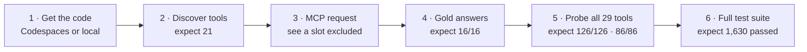

# 06 · Reproducibility

> Run the MCP server and reproduce the headline numbers in about **10 minutes**. **No IBM Cloud, voice or database credentials needed**: the local path uses bundled synthetic fixtures.

---



## 1 · Get the code

**Option A: GitHub Codespaces.** On the repository page select **Code → Codespaces → Create codespace on main**, then open a terminal.

**Option B: your machine.** Install Git, Python 3.12 and [uv](https://docs.astral.sh/uv/getting-started/installation/).

```bash
git clone https://github.com/gsa-mcp-hackathon/veteran-access-bridge-mcp-server.git
cd veteran-access-bridge-mcp-server
git rev-parse HEAD                              # record the commit with your results
uv sync --locked --group dev --python 3.12
```

<details><summary>Using pip instead of uv</summary>

```bash
python -m venv .venv && source .venv/bin/activate      # Windows: .\.venv\Scripts\Activate.ps1
python -m pip install -r requirements.txt
python -m pip install --no-deps -e .
```
Then drop `uv run --no-sync` from the commands below.
</details>

## 2 · Discover the tools

```bash
uv run --no-sync python scripts/list_local_mcp_tools.py
```

The client starts the server as a child process and talks MCP over standard input and output. **Expected output (end):**

```text
validate_booking_preconditions
validate_option_selection
verify_synthetic_identity
21 tools advertised by this configuration
```

The optional CRM and agent-scheduling groups are off by default; step 5 turns them on to reach 29.

## 3 · Make a real MCP request

Ask which openings an established Primary Care patient can use:

```bash
uv run --no-sync python scripts/read_scheduling_encounter.py DEMO-PC-5000999-001
```

**Expected output (excerpt):** one slot is excluded, with the reasons, and nothing is booked.

```json
{
  "patient_classification": "ESTABLISHED",
  "slot_eligibility": [
    { "slot_id": "VISTA-SLOT-PC-5000999-001", "eligible": true,  "reasons": ["ELIGIBLE"] },
    { "slot_id": "VISTA-SLOT-PC-5000999-002", "eligible": false,
      "reasons": ["PATIENT_CLASSIFICATION_MISMATCH", "APPOINTMENT_INTENT_MISMATCH", "TEMPLATE_MISMATCH"] },
    { "slot_id": "FEHR-SLOT-PC-5000999-001",  "eligible": true,  "reasons": ["ELIGIBLE"] }
  ],
  "read_only": true,
  "booking_created": false
}
```

Now ask for a case that doesn't exist:

```bash
uv run --no-sync python scripts/read_scheduling_encounter.py UNKNOWN-CASE
```

**Expected:** the server refuses: `Error calling tool 'get_scheduling_encounter': Unknown synthetic case_id 'UNKNOWN-CASE'.`

## 4 · Check the answers

```bash
uv run --no-sync python eval/primary-care/run_gold.py
```

**Expected:** `16/16 gold answers matched`. Each run makes fresh MCP calls; a mismatch prints expected and observed values.

## 5 · Probe all 29 tools

```bash
export VAB_ENABLE_CRM=true VAB_ENABLE_AGENT_SCHEDULING=true
uv run --no-sync python eval/probe_mcp_contracts.py   --output-dir out/contracts
uv run --no-sync python eval/probe_mcp_adversarial.py --output-dir out/adversarial
```

**Expected:**

```text
{"probes": 126, "passed": 126, "failed": [], "timing_samples": 120}
{"executed": 86, "passed": 86, "failed": []}
```

Per-check results are written as JSON to the output directories. Use a new directory for each run.

## 6 · Run the full test suite

```bash
uv run --no-sync pytest -q tests
```

**Expected:** `1630 passed, 20 skipped`.

Every expected output on this page was captured from the public repository on November 23, 2026.

## Follow the answer through the code

| File | What to look for |
|---|---|
| [`mcp/tools/get_scheduling_encounter.py`](../../src/veteran_access_bridge/mcp/tools/get_scheduling_encounter.py) | The MCP entry point used in step 3 |
| [`services/slot_matching.py`](../../src/veteran_access_bridge/services/slot_matching.py) | The rules that produce the exclusion reasons |
| [`mcp/session_scope.py`](../../src/veteran_access_bridge/mcp/session_scope.py) | Case binding, turn capabilities and tool allowlists |
| [`tests/test_m6_2_primary_care_scenarios.py`](../../tests/test_m6_2_primary_care_scenarios.py) | Primary Care scenario assertions |
| [`tests/test_mcp_scope_adversarial.py`](../../tests/test_mcp_scope_adversarial.py) | Adversarial scope tests |

## What needs credentials

The full Avery voice path (IBM watsonx Orchestrate, LiveKit, Deepgram, Supabase and IBM Code Engine) requires separately authorized accounts and is not needed to verify the server. The November 23 hosted evaluation in [Section 04](../04-evaluation/README.md#hosted-evaluation-november-23) was run this way from Codespaces.

Guides: [Connected services over HTTP](../../docs/developer-guide/connected-product.md) · [IBM watsonx Orchestrate](../../docs/developer-guide/avery-ibm-start.md) · [Configuration and secrets](../../docs/developer-guide/configuration-and-secrets.md)

## Rules for safe testing

- Synthetic fixtures only; never place real Veteran data in any environment.
- Do not reuse consumed booking cases such as `DEMO-PC-VOICE-INTAKE-001`.
- Keep credentials in approved secret storage, never in Markdown or GitHub Pages.

**More:** [Local MCP server guide](../../docs/developer-guide/local-mcp-server.md) · [VS Code](../../docs/developer-guide/vs-code.md) · [Codespaces](../../docs/developer-guide/codespaces.md) · [Clean-room reproducibility](../../docs/developer-guide/clean-room-reproducibility.md) · [Troubleshooting](../../docs/developer-guide/troubleshooting.md)

**Back to:** [Submission index](../README.md)
