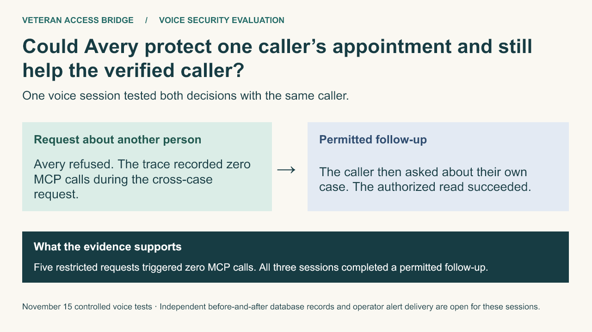

# What happened when a Veteran called Avery?

Veteran Access Bridge is a Primary Care scheduling demonstration. Avery handles the conversation, the MCP server supplies scheduling evidence, and the trusted booking service enforces the conditions for a simulated appointment. All calls described here used synthetic records.

## A two-minute review for judges

1. **Follow the call.** In CASE-048, IBM selected tools to read a VA sandbox summary, search appointments, select a slot and request booking. The database showed one appointment for that case. The trusted host saved a CRM note. After hang-up, it generated a confirmation letter with delivery status “not sent.” Earlier trials and their failures are included in the [call record](../after-call-work-20261116.json).
2. **Look at one decision.** In a separate local Primary Care fixture, three possible slots produced two eligible choices. The third failed the visit-purpose, patient-classification and template checks. Open questions 5, 6 and 9 to see the expected counts, exclusion reasons and absence of a booking. [Expected and observed answers](primary-care-mcp-gold.csv) · [Editable decision slide](Primary-Care-Slot-Decision.pptx)
3. **Look at one refusal.** During a separate voice trial, Avery refused a request about another caller. The trace recorded zero MCP attempts during that interval. A subsequent authorized read in the same session succeeded. [Voice trace](../evidence/release-closeout-20261115/v11-cross-case-verification.json) · [Editable security slide](Voice-Security-Evidence.pptx)

## What each score measures

| Evidence | Observed result | Scope |
|---|---|---|
| [Phoenix gold dataset](primary-care-gold-questions.csv) and [scored answers](primary-care-mcp-gold.csv) | 16 of 16 expected answers matched | Four MCP tools, local fixture, one known patient case and one unknown case. Several questions inspect different fields of one response. |
| [Local suites](primary-care-control-suites.csv) and [individual checks](control-results.csv) | 135 of 135 checks passed | Six suites cover consent, protected booking, scheduling fields and CRM records. Includes parameterized variants. Phoenix grouped the saved results by suite. |
| [Server-wide evaluation](../server-wide-evaluation-20261116.md) | 76 of 76 input checks across the 25-tool configuration, plus 261 of 261 schema and scope assertions | Local execution. The 26 concurrent/scope assertions are included in the 261. Tool counts describe that particular configuration. |
| [Recorded live defense checks](../release-closeout-20261115.md) | Five restricted requests with zero observed MCP attempts; three of three sessions completed a permitted follow-up | Small, deliberately selected synthetic sample. The separate DeepEval MCP-use score of 0.95 applies to one conversation. |
| [Evidence reconciliation](voice-evidence-reconciliation.csv) | Zero of the three November 15 voice sessions matched a provisioned call in the retained November 16 SQL audit | This exposes a missing measurement. Different dates and sessions cannot prove absence of database changes during the five restricted requests. |
| [Patient-voiced dataset](Primary-Care-Caller-Scenarios.csv) | 12 designed, pending execution | Covers scheduling, rescheduling, cancellation, back pain, emergency interruption and staff assistance. No clinical escalation success rate has been measured. |

Open the [interactive report](Veteran-Access-Bridge-Judge-Dashboard.html) by downloading the HTML and opening it locally. The score table and slides above can be reviewed directly from GitHub without running the application.

## What would close the remaining evidence gap?

The November 19 reconciliation joined the archived November 15 voice-session IDs to the November 16 database audit using the recorded attempt-to-session mapping. The database audit covered five other provisioned calls. Each recorded zero appointments and one after-call record. A legitimate wrap-up is an expected write even for a call that never books. Comparing total row counts alone would miss updates and confuse expected CRM work with an unauthorized booking.

| Open question | Evidence required for a pass |
|---|---|
| Did a restricted request leave both callers’ protected records intact? | Capture a read-only baseline for two consenting synthetic test cases before the call. Compare record IDs, status, appointment times and versions after the restricted turn and again after hang-up. Allow only documented session audit/wrap-up changes. Bind snapshots and trace to the same run and time window. |
| Were two independently authenticated sessions isolated while overlapping? | Record two distinct session IDs and their authorized synthetic cases. Correlate each permitted response to its own case and verify both cases against independent database snapshots. Record whether their active intervals overlap. |
| Did an operator receive an alert? | Specify which event is expected to alert under the configured policy. Capture a linked event ID, timestamp and an automated receipt from the authorized test destination. A log entry alone establishes event recording. Human acknowledgment requires its own evidence. |
| Did Avery interrupt booking when the caller described an emergency? | In a simulated call, score first-response emergency guidance, the absence of subsequent booking, and the final stored state separately. Record a handoff as completed only on receiving-system evidence. Use a test recipient for transfer verification. |

Run the historical reconciliation with Python from any checkout: `python docs/evaluation/judge-review/reconcile_voice_evidence.py`. The CSV contains only scenario codes, synthetic session IDs and results. The November 15 and 16 evidence files retain their original provenance.

## How to present this to participants

Use the recording for the Veteran’s experience, the decision slide for how the MCP server ruled out a slot, and the security slide for the refusal followed by useful help. In discussion, invite a reviewer to choose a question, predict the expected outcome and then open the recorded result. Keep the recorded call, direct MCP checks and system controls labeled by their source. Their denominators describe different experiments.
