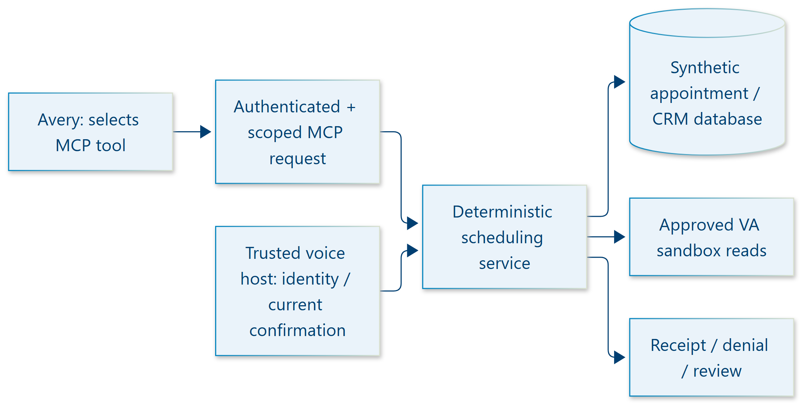

# 02 · MCP architecture

The **Python FastMCP server is the deliverable.** Avery, the IBM watsonx Orchestrate voice agent, is one client of it. Any MCP-capable SI agent can discover the same tools; none of them receives booking or patient-scope authority by doing so.

## Layers and responsibilities

| Layer | Technology | Responsibility | Holds authority? |
|---|---|---|---|
| Caller audio | Browser, LiveKit, Deepgram speech | Real-time voice session and speech recognition | No |
| Trusted voice host | LiveKit voice worker and trusted backend | Verifies the spoken identity, binds the call and participant to one case, captures the caller's current confirmation | **Yes** (identity, confirmation) |
| SI agent | IBM watsonx Orchestrate, Avery, Anthropic Claude Sonnet 4.6 via AWS Bedrock, 8 behavior guidelines | Runs the conversation, chooses MCP tools, explains results | No |
| MCP server | Python FastMCP (`veteran-access-mcp`) | Typed tool schemas, service authentication, case and session scope, structured results or explicit denials | **Yes** (scope) |
| Deterministic services | Python services in `src/veteran_access_bridge/services` | Eligibility, access standards, slot matching and ranking, consent and policy gates, idempotent commits | **Yes** (policy, booking) |
| VA interfaces | VHA sandbox adapters | Read-only facility, patient-health, clinical and Community Care sandbox context | No (read-only) |
| Data | Supabase PostgreSQL | Synthetic appointments, consent, audit events and CRM records; row-level security on audited tables | Enforces DB access |
| Knowledge | Call-scoped retrieval (`search_call_knowledge`) | Supporting content; retrieved text is evidence, never authority | No |
| Hosting | IBM Code Engine | Containerized backend and voice worker | n/a |

## How one protected request is governed

1. **Agent requests.** Avery selects an attached tool and supplies arguments. The model's arguments are treated as untrusted input.
2. **Transport is authenticated.** Remote MCP calls require a service bearer credential; missing or wrong credentials are rejected with HTTP 401 (3/3 recorded denials).
3. **Scope is checked.** The server binds the call to one case through short-lived, opaque turn capabilities, applies a per-session tool allowlist and denies replays. A case ID in the arguments does not grant access to that case.
4. **Policy decides.** Deterministic services check verified identity, current explicit consent, slot freshness and booking rules, and require a signed host grant for a booking.
5. **Write is committed once.** Writes are idempotent; forged or replayed requests are rejected.
6. **Result is verified.** The booking service reads the record back from the database before success is reported, and returns a structured receipt. A denial is returned as an explicit, structured result, never as model prose.

## The 29 tools

The server registers **29 tools** when the optional CRM and agent-scheduling groups are enabled. **21 are attached to Avery**; **8** restricted handoff and control tools are intentionally not attached. The default local configuration, with those groups off, advertises 21.

| Capability group | Tools | Attached to Avery | Write tools |
|---|---|---|---|
| Identity | `verify_synthetic_identity` | 1 of 1 | none |
| Scheduling | `determine_workflow_state`, `search_availability`, `get_scheduling_encounter` | 3 of 3 | none |
| Access | `assess_access_standard`, `check_community_care_eligibility` | 2 of 2 | none |
| Lifecycle and handoff | `get_case_lifecycle_state`, `prepare_scheduling_handoff`, `get_scheduling_handoff`, `validate_option_selection`, `record_option_selection`, `prepare_veteran_confirmation_request`, `record_veteran_confirmation`, `validate_booking_preconditions`, `record_lifecycle_event` | 1 of 9 | 5 |
| VA sandbox (read-only) | `get_va_sandbox_health_facility`, `search_va_sandbox_health_facilities`, `get_va_sandbox_health_facility_service`, `get_va_community_care_case_summary`, `get_va_patient_health_sandbox_summary`, `get_va_clinical_health_case_summary` | 6 of 6 | none |
| CRM | `get_crm_case`, `record_crm_interaction`, `create_crm_follow_up`, `update_crm_follow_up` | 4 of 4 | 3 |
| Avery voice | `search_call_appointments`, `select_call_appointment`, `book_call_appointment`, `search_call_knowledge` | 4 of 4 | 2 |
| **Total** | **29** | **21** | **10** |

Every tool carries MCP annotations; the 10 write tools are the ones not marked `readOnlyHint`. The full catalog, with a description and source link for each tool, is on the [MCP implementation page](../../docs/mcp-implementation.md).

**Why 8 tools are not attached:** the lifecycle and handoff tools implement the human-review path (preparing a handoff, recording a scheduler's selection, recording a Veteran's confirmation). Keeping them off the voice agent means the agent cannot complete a review step that belongs to a person.

**Knowledge:** `search_call_knowledge` is one retrieval interface, not four separate knowledge tools. Retrieved text cannot raise the caller's privileges.

## Engineering decisions

| Decision | Why | Reference |
|---|---|---|
| Authority lives outside the model | Identity, consent and booking rights cannot be issued by model output | ADR-001 |
| Synthetic Supabase PostgreSQL instead of VA systems | No CDW or production appointment-writer access; still needed durable, relational, auditable state | ADR-002 |
| IBM watsonx Orchestrate and Code Engine | Managed agent workspace with tool attachment, plus container hosting | ADR-003 |
| LiveKit and Deepgram | Real-time browser voice with speech services | ADR-004 |
| Policy-gated synthetic booking | Availability is not authorization; booking requires identity, scope, consent and slot freshness | ADR-006 |

Full rationale and trade-offs: [Engineering decisions](../../docs/developer-guide/engineering-decisions.md).

## Source map

| Path | Contents |
|---|---|
| [`src/veteran_access_bridge/mcp/app.py`](../../src/veteran_access_bridge/mcp/app.py) | FastMCP server and tool registration |
| [`src/veteran_access_bridge/mcp/tools/`](../../src/veteran_access_bridge/mcp/tools) | One module per tool or tool group |
| [`src/veteran_access_bridge/mcp/session_scope.py`](../../src/veteran_access_bridge/mcp/session_scope.py) | Turn capabilities, case binding and tool allowlists |
| [`src/veteran_access_bridge/services/`](../../src/veteran_access_bridge/services) | Deterministic eligibility, slot matching and policy services |
| [`db/`](../../db) | Synthetic database schema and setup |
| [`frontend/`](../../frontend/SNAPSHOT.md) | Companion browser app (release snapshot) |

**Historical note:** the original [calling-scenario diagram](../../docs/assets/architecture-calling-scenario.png) shows an earlier 21-tool inventory and is kept for reference. Counts from different versions are not interchangeable.

**Read more:** [Solution & architecture](../../docs/solution-architecture.md) · [MCP implementation](../../docs/mcp-implementation.md) · [Security & governance](../../docs/security-governance.md)
